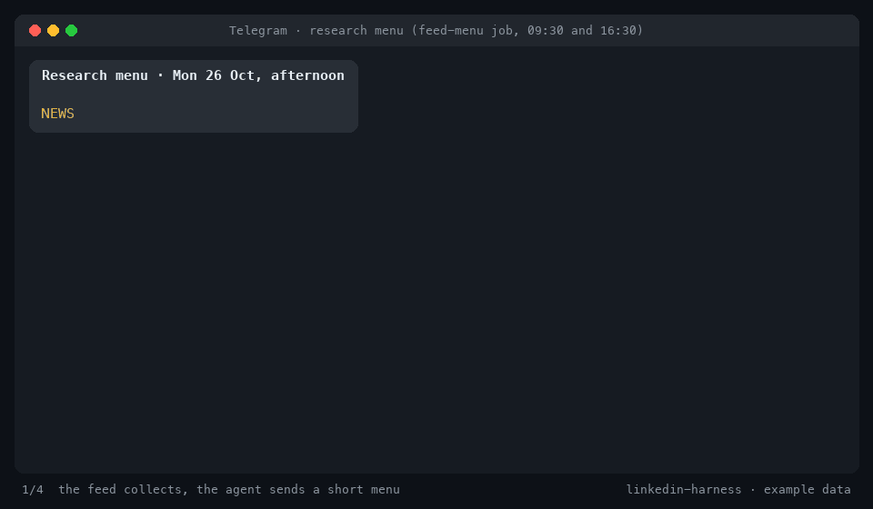

# LinkedIn Harness

A harness for running LinkedIn with AI agents: research comes in on a schedule, you pick from a
short menu in chat, the agent drafts in your voice, and nothing goes out without your exact
approval.



<sub>Example data. The menu, pick and publish outputs come from real runs of the scripts; the final post line is illustrative.</sub>

It is not a prompt pack and not an auto-poster. It is the plumbing around an agent you already
use (Claude Code, Codex, Hermes, or anything that can run a script and read a skill file):
a research feed, the prompts for the scheduled jobs, writing skills, draft templates, a
dashboard, and adapters for LinkedIn.

```text
producers (news, skills, repos, discussions, reels)
   → feed service (dedupe, scores, statuses)
   → research menu in your chat, twice a day
   → you: "news post about 2"
   → writer skill: evidence ledger → hook → draft in VOICE.md → anti-AI-writing pass → visual
   → you approve the exact text → publish adapter → metrics → one lesson for the next post
```

## What's in it

| path | what |
|---|---|
| `feed/` | the research feed: producers, SQLite store, HTTP API, CLI, job prompts and run scripts. Python standard library only. |
| `skills/linkedin-writer/` | the writing workflow: research modes, evidence, a hook library, statuses, approval rules |
| `skills/feed/` | how the chat agent resolves "the second one" to a feed item and hands it to the writer |
| `skills/anti-ai-writing/` | banned words, banned shapes, and `clean.py`: strips invisible characters and flags every tell by line |
| `skills/linkedin-comment/`, `linkedin-reply/` | comments under other people's posts (or "skip"), and triaged replies under your own |
| `skills/linkedin-inbox/`, `linkedin-outreach/` | DM and invite triage, and one-person outreach only when there is a real reason |
| `skills/linkedin-week/`, `linkedin-audit/` | the week's plan from the feed and your drafts; the post-mortem from your own numbers |
| `skills/linkedin-repurpose/`, `linkedin-carousel/` | one long source into standalone posts; carousels rendered as PDF from your visual style |
| `skills/linkedin-profile/` | a 100-point profile rubric and rewrites, weakest part first |
| `skills/skill-radar/` | vetting and safely testing agent skills and repos before writing about them |
| `skills/skill-posts/` | outline for your own skill-and-repo post rules (you fill it in) |
| `templates/` | `VOICE.md`, `VISUAL_STYLE.md`, `ACTIVE.md`, `draft.md`, `COMMENT_QUEUE.md`, `POSTS.md` |
| `dashboard/` | a static dashboard served by the feed: feed stats, items, latest posts |
| `scripts/` | `linkedin_publish.py` (free posting through LinkedIn's API, hash-guarded), `quality_check.py` (draft preflight), `collect_linkedin_metrics.py` (own-post numbers through a browser bridge) |
| `docs/` | architecture, growth system, research playbook, adapters, feed reference, scheduling, deploy |

## Quick start

Requires Python 3.11+. No packages to install.

```bash
git clone https://github.com/Oxde/linkedin-harness.git
cd linkedin-harness
cp .env.example .env                                   # FEED_URL, FEED_TOKEN, optional keys

# 1. Run the feed locally and fill it
FEED_ALLOW_NO_TOKEN=1 FEED_DB=./feed.db python3 -m feed.service &
python3 -m feed.collect
python3 -m feed.feedctl menu                           # the raw menu the agent turns into a message

# 2. Make the workspace yours
mkdir -p ~/linkedin && cp templates/*.md ~/linkedin/   # fill VOICE.md first; it wins over every rule

# 3. Give your agent the skills
cp -r skills/* ~/.claude/skills/                       # or your agent's skills directory
```

Then open the dashboard at http://127.0.0.1:4872, schedule the jobs (`docs/scheduling.md`), and set up
free posting (`docs/publishing.md`): one LinkedIn developer app, one token, no paid tools.

## Install just the skills

The 14 skills work in any agent that reads `SKILL.md` files. The feed, the dashboard and the
publish script need the full clone above.

```bash
npx skills add Oxde/linkedin-harness                       # any agent, via the skills CLI

claude plugin marketplace add Oxde/linkedin-harness         # Claude Code plugin
claude plugin install linkedin-harness@linkedin-harness

git clone https://github.com/Oxde/linkedin-harness && cp -r linkedin-harness/skills/* ~/.agents/skills/   # Codex
```

## Make it yours

The harness ships the method; your voice is yours. These files are templates on purpose:

- **`VOICE.md`** — positioning, lane, audience, how you sound, words you never use, proof you can
  publish. The menu and the desks judge every item against the audience written here.
- **`VISUAL_STYLE.md`** — an outline for your image style: formats, colour tokens, type, material,
  composition, rendering, checklist.
- **`skills/skill-posts/`** — section names and what each should hold; write the rules from your
  own posts that people saved.
- **`feed/sources.txt`** — the channels, feeds, queries and watchlists for your niche. The shipped
  set is an example for an AI-agents lane.

## Safety

- No post, comment, reaction, connection, follow or DM without the user's approval of the exact
  payload. The prompts and skills say so in every place an agent could act.
- Scouted skills and repos are never installed or executed during scheduled runs.
- No passwords, cookies or API keys travel through chat or live in this repo. Keys come from the
  environment; LinkedIn reading uses your own logged-in browser session.
- Feed items from Telegram and discussion sites are leads, never facts. Facts come from the
  primary source.

## Docs

- [Architecture](docs/architecture.md) — the four loops and the folder model
- [Growth system](docs/growth-system.md) — the four queues, the quality bar, statuses
- [Research playbook](docs/research-playbook.md) — research modes, comment and reply rules
- [Posting for free](docs/publishing.md) — your own LinkedIn app, a token, and a hash-guarded publish script
- [Adapters](docs/linkedin-adapters.md) — publishing, reading, data APIs, other platforms
- [Research feed](docs/research-feed.md) — lanes, statuses, API, environment
- [Scheduling](docs/scheduling.md) — cron, Claude Code, Hermes
- [Deploy to Railway](docs/deploy-railway.md)

## Tests

```bash
python3 -m unittest discover -s feed/tests -t .
(cd dashboard && python3 -m unittest discover -s tests)
python3 -m unittest discover -s scripts/tests
```

## License

MIT
